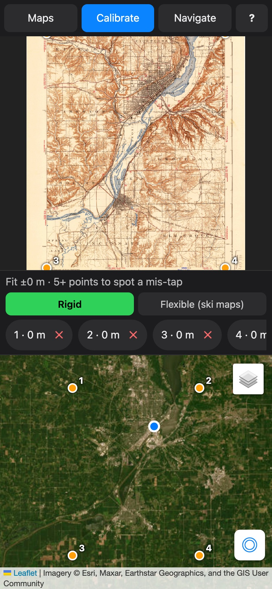
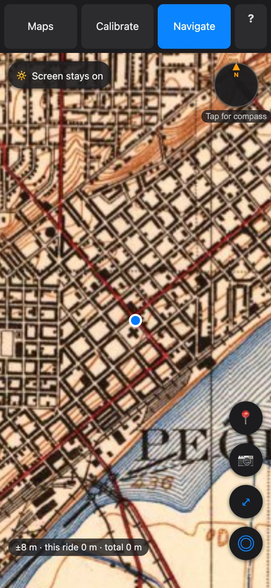

# You Are Here

**Put a live GPS dot on a photo of any trail map.**

Take a picture of a trailhead board, download a club's PDF, or open a century-old
survey map. Match a couple of spots on it to satellite imagery, and from then on the
app shows where you are *on that map*, as you walk.

<p align="center">
  
  &nbsp;
  
</p>
<p align="center"><sub>The built-in demo: the USGS Peoria, Illinois quadrangle of 1905, calibrated to
today's satellite view (left), with a GPS position in downtown Peoria shown on the 1905
street grid (right).</sub></p>

**Try it on your phone: <https://ryanfunk021.github.io/youAreHere/>**, then tap
**Try the demo map**. There's no account and nothing to install.

## What it does

- **Any map:** a photo, a screenshot, or a PDF (it asks which page).
- **Zero-tap GeoPDFs:** PDFs with built-in coordinates (USGS topos, many
  NPS/USFS maps, in either the OGC LGIDict or ISO 32000 format) are calibrated
  automatically, with proj4 handling their projection and datum.
- **Calibrate with 2+ taps:** tap a spot on the map, then the same spot on
  satellite or street-map imagery. Two pairs are enough. With more, it reports the
  fit error and flags a mis-tapped point.
- **Flexible fit for ski maps:** painted, panoramic maps get a thin-plate-spline
  warp through every pair instead of one rigid fit.
- **Navigate:** your live position, breadcrumb dots saved per map in sessions you
  can pause, end, resume and crop, free pan/zoom, an orienteering compass for
  lining the map up with the land, and a battery saver.
- **Waypoints:** paste coordinates or a Google/Apple Maps link to get a highlighted
  ⭐ with distance and direction. Share one as a link.
- **Hike photos:** shown as camera dots, placed by the photo's location or by
  matching its time to your trail.
- **Private by design:** everything stays on the phone. There's no backend; the
  only network use is map tiles while calibrating.

It works with the screen on (a web page can't track GPS in a locked pocket). It can
be added to the home screen, and it **works offline** after the first visit (in Safari
and the home-screen app; iOS doesn't allow it inside Chrome).

**Field-tested** on real trails by the friend who asked for it. Full instructions,
with screenshots, are in the app (**?**) and at
<https://ryanfunk021.github.io/youAreHere/#help> (source:
[`public/instructions.md`](public/instructions.md)).

## How it works

- **Calibration** maps photo pixels to a local plane around the map's centre (a
  sinusoidal projection, so meridians converge as on a real map). Two pairs give an
  exact rotation + scale + shift. Three or more give a least-squares affine fit. GPS
  positions go through the inverse. **Flexible** mode adds a thin-plate spline (exact at every pair,
  relaxing to the affine far away, inverted by Newton's method). On a synthetic
  panorama it cuts the median error from 127 m to 39 m and flags folds from
  mis-taps.
- **Error you can trust:** the residual of a single point can't identify a mis-tap
  (in simulation it names the wrong point about half the time). The app flags the
  point whose *removal* most improves the fit, which is right about 94% of the time
  with 5 pairs.
- **PDFs** are rasterized on the phone with pdf.js. Maps, trails, photos and
  waypoints live in IndexedDB.
- It's a **static site** (Vite + TypeScript + Leaflet) on GitHub Pages.
  [`src/georef.ts`](src/georef.ts) holds all the math, with no DOM or map-library
  dependency.

## Develop

```sh
npm install
npm run dev        # http://localhost:5173/youAreHere/
```

Phones only allow GPS on HTTPS pages, so to test GPS on a phone, push to `main`.
GitHub Actions then deploys to Pages. Calibration works over plain HTTP on the LAN
(`npm run dev -- --host`).

## Maps and copyright

Most trail, club and resort maps are copyrighted. Load your own copies into the app,
but don't commit them to this repo (images and PDFs are git-ignored, apart from the
demo and help screenshots). US government maps from USGS and NPS are public domain.

## Credits and license

- **Demo map:** U.S. Geological Survey, *Peoria, Illinois* 1:62,500 quadrangle,
  edition of 1905 (reprinted 1940), from the USGS Historical Topographic Map
  Collection. Public domain.
- Imagery © Esri and contributors. Street map © OpenStreetMap contributors.
- Code: GPL-3.0.
