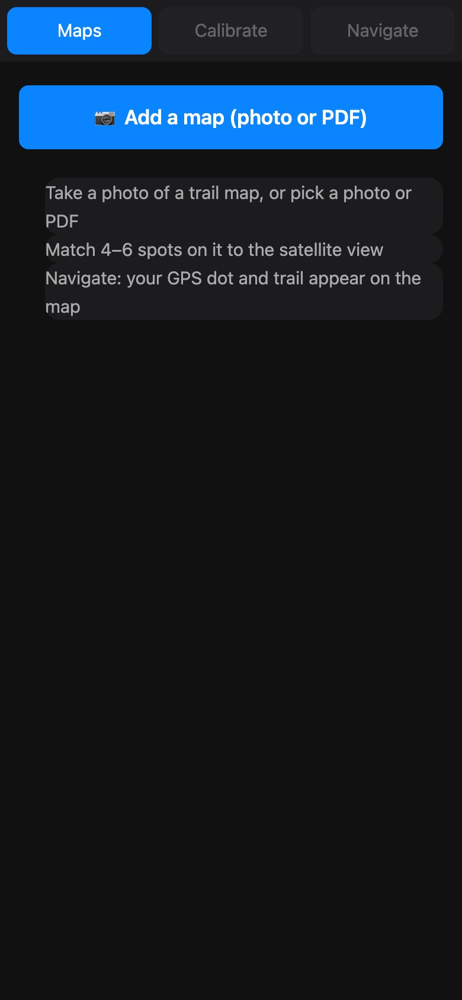
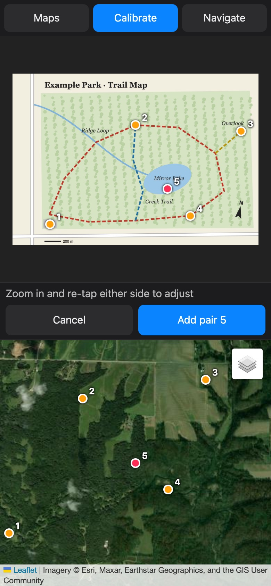
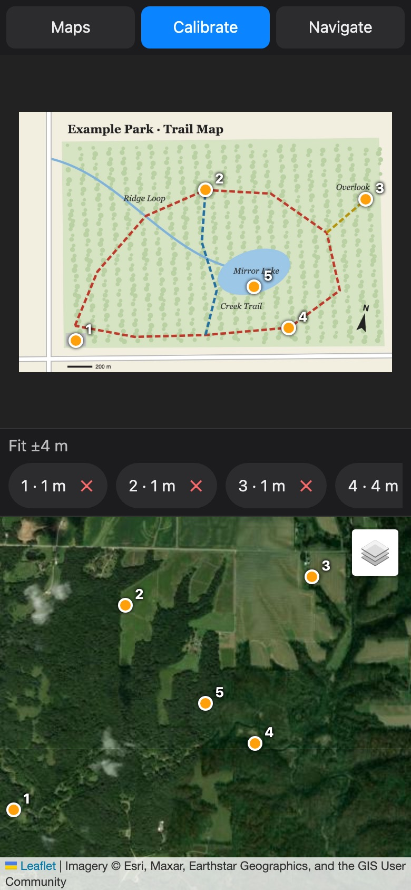
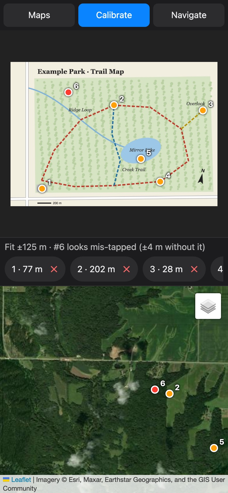
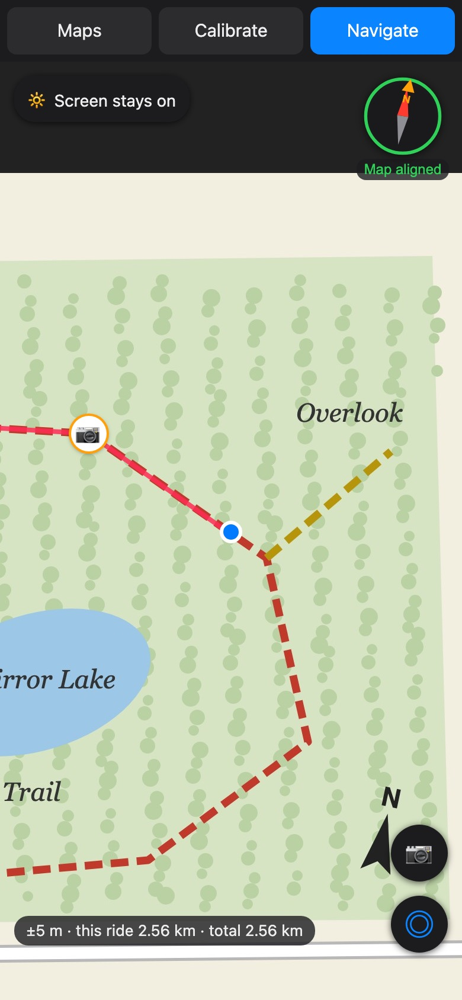
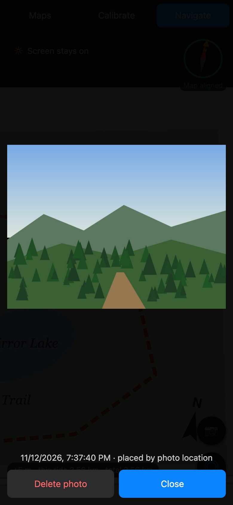
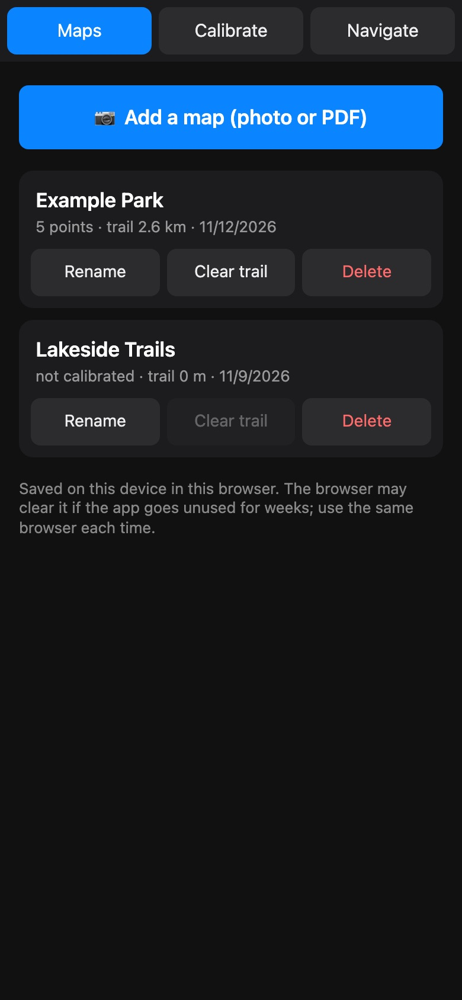
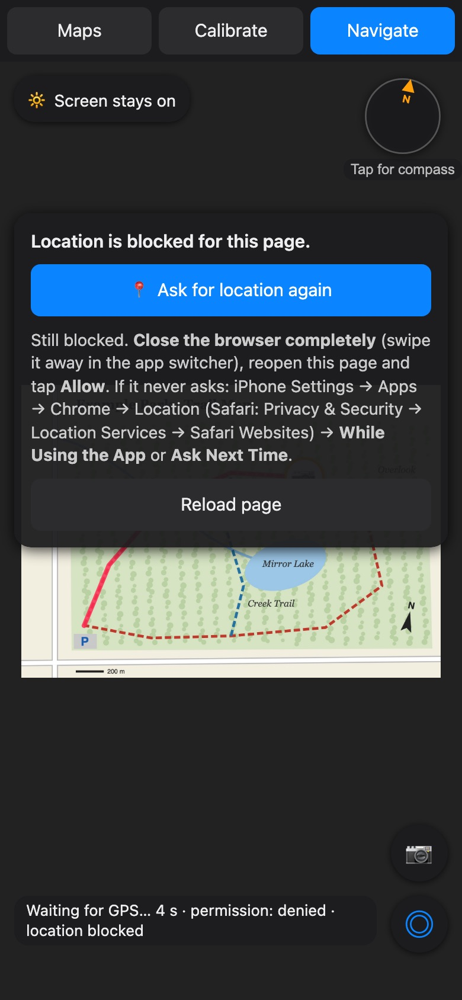

# How to use You Are Here

You Are Here puts a live GPS dot on a picture of a trail map: a photo of a
trailhead board, a park brochure, or a PDF from a club website. You line the map up
with satellite imagery once. After that it shows where you are *on that map*, draws
the trail you've covered, and pins the photos you took along the way.

Everything stays on your phone. The only thing it downloads is satellite and street
map tiles, and only while you're lining a map up.

*The screenshots below use a made-up example map.*

---

## 1. Add a map

Tap **Add a map (photo or PDF)**. You can take a photo, pick one from your library,
or choose a PDF. If the PDF has several pages, the app asks which page is the map.

Tips for a good photo:

- Stand straight in front of the board, not at an angle.
- Get the whole map in the frame, and avoid glare.
- A PDF is better than a photo when the club or park offers one.

## 2. Line it up (Calibrate)

This is the one step that takes a minute. You match spots on your map (top) to the
same spots on the satellite view (bottom).

1. Tap a spot on the **map**, such as a trail junction, a parking lot, a road
   crossing or the tip of a lake.
2. Tap the **same spot** on the satellite view.
3. If either tap is a little off, zoom in and tap again. Then press **Add pair**.

Do this for **4 to 6 spots spread around the edges** of the area you'll be in. Once you
have three pairs, tapping the map jumps the satellite view to where the app thinks that
spot is, so the rest go quickly.

**Trails hidden by trees?** Tap the layers button (top right of the satellite view)
and choose **Map** or **Map overlay**. Street-map lines show the trails, so you can tap
real junctions.

**Fit ±N m** tells you how well your spots agree. Single digits are great; under
about 15 m is fine for finding the right trail at a junction.

With 5 or more pairs, the app spots a **mis-tap** and turns it red, along with how good
the fit would be without it. Delete it with **✕** and redo it.

## 3. Navigate

Allow location when asked. The **blue dot** is you. The faint circle around it shows
how sure the GPS is: expect ±5 m outdoors, and much worse indoors. Your trail is drawn
in red as you move, and the map follows you as you get near the edge. **◎** puts you
back in the middle.

**Line the map up with the land.** The orange **N** on the compass shows where north
is on *your map*. Tap the compass to turn on the phone's compass (iPhone asks first).
A red needle then points to real north. Hold the phone flat and turn yourself until
they line up and it says **Map aligned**. Now left on the map is left in front of you.

**Battery.** By default the screen stays on. Tap **Screen stays on** to switch to
**Battery saver**: the screen can turn off as usual, and your trail is recorded
whenever you look at the map, joined up in between. A web page can't use GPS while the
screen is off, so this is the trade-off.

## 4. Hike photos

Tap **📷** to add photos, during the hike or after it. Each one appears as a camera dot
on the map. Tap a dot to see the photo.

The app places each photo using the first of these that works:

1. the location saved in the photo,
2. the time it was taken, matched to your recorded trail,
3. where you are right now, if you just took it.

iPhones often remove the location from photos you give a website, which is why your
trail's times matter. After adding photos the app tells you how each one was placed,
and which it couldn't place.

## 5. Your maps

**Maps** lists every map on this phone, with its calibration and trail. Tap one to
open it. **Rename**, **Clear trail** and **Delete** do what they say.

Your maps are saved **in this browser on this phone**. Use the same browser each time,
not a private tab. If you don't open the app for a few weeks, the browser may clear it.

---

## Troubleshooting

**"Location is blocked."** Tap **Ask for location again**. If it's still blocked,
close the browser completely (swipe it away in the app switcher) and open the page
again, then tap **Allow**. If it never asks, open iPhone **Settings → Apps → Chrome →
Location** (Safari: **Privacy & Security → Location Services → Safari Websites**) and
choose **While Using the App**.

**"Waiting for GPS" for a long time.** You're probably indoors. Step outside or near a
window. The status shows how long it has waited.

**"screen may sleep."** The phone wouldn't let the app keep the screen on. For a long
hike, set **Settings → Display & Brightness → Auto-Lock** to a longer time.

**"Compass not allowed."** Tap the compass again and choose **Allow**. Some browsers
don't offer a compass at all; the orange **N** still shows where north is on your map.

**A big PDF takes a while.** The loading screen shows each step with a timer. Large
park brochures can take a few seconds to draw.

**The dot is on the wrong trail.** Re-check your pairs on **Calibrate**. Add a pair
near where it went wrong, and delete any red ones.
