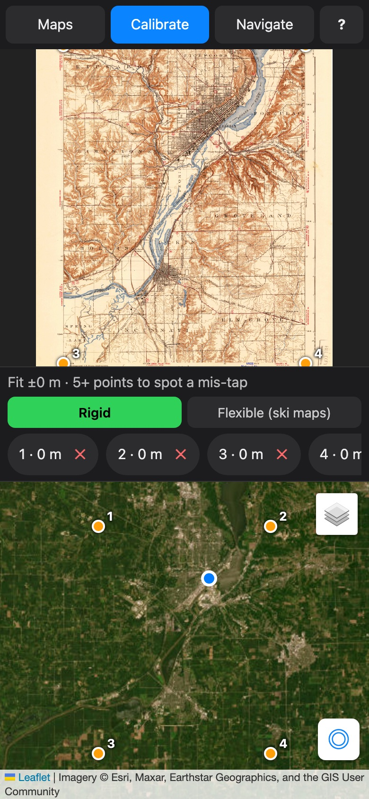
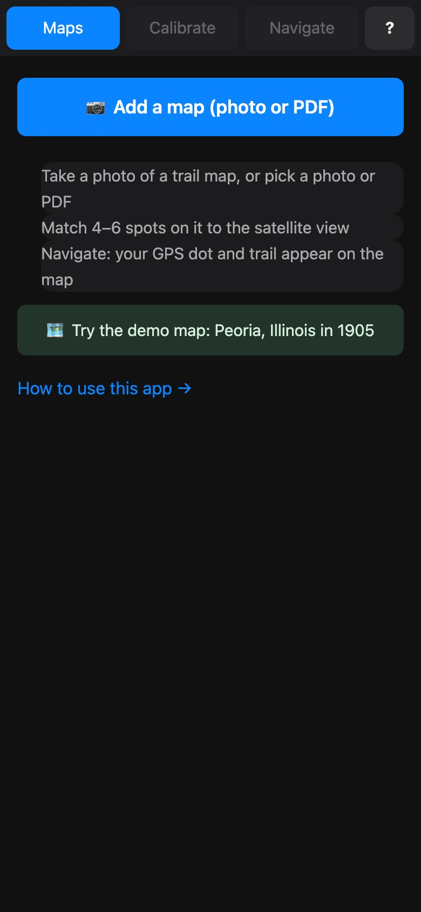
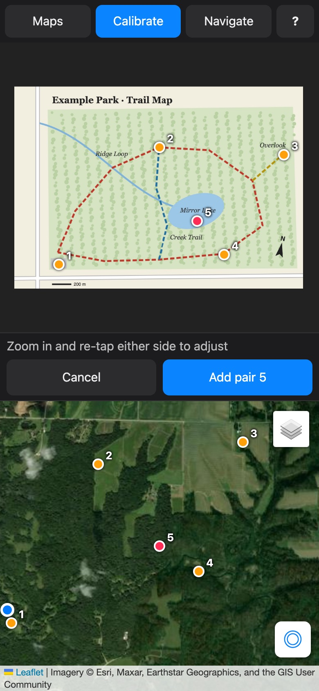
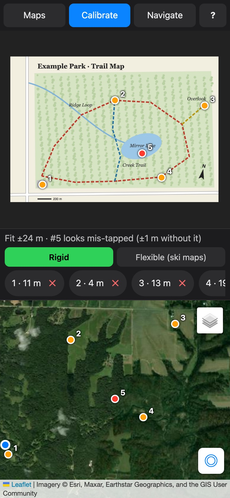
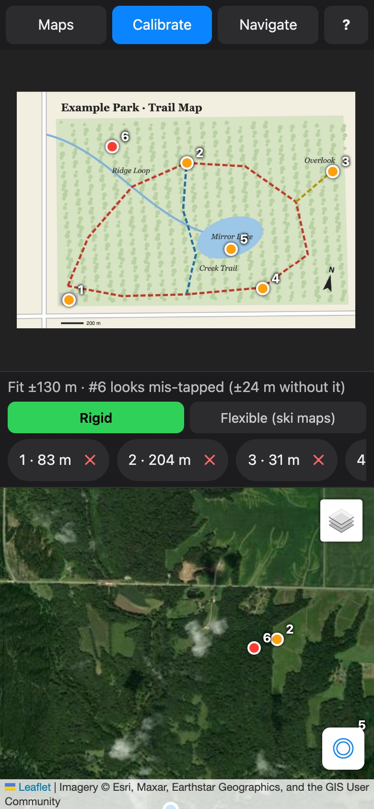
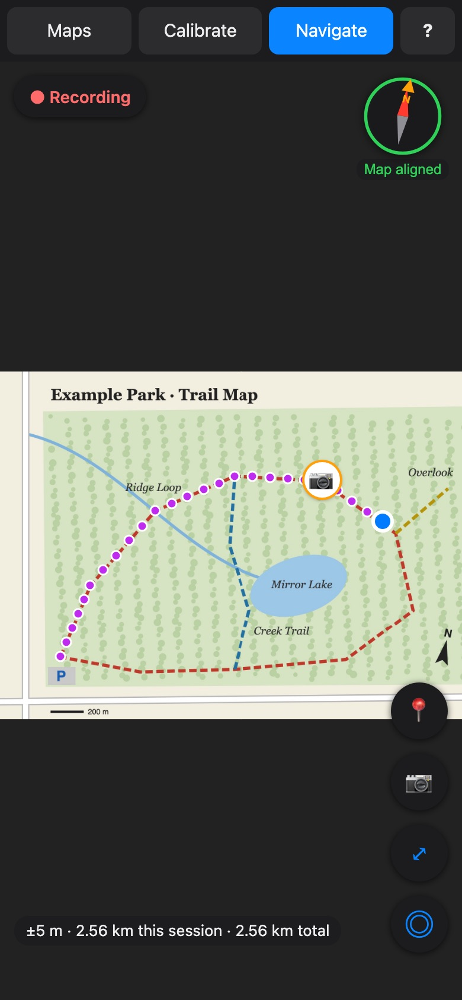
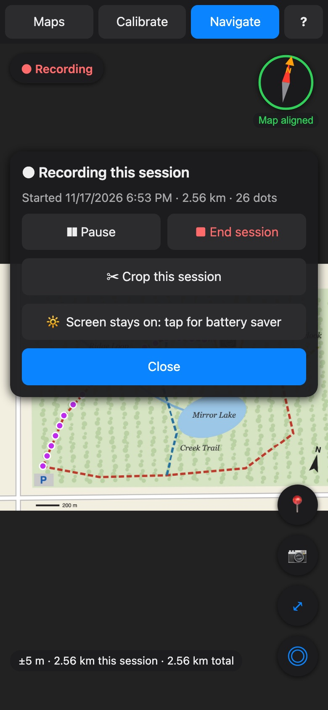
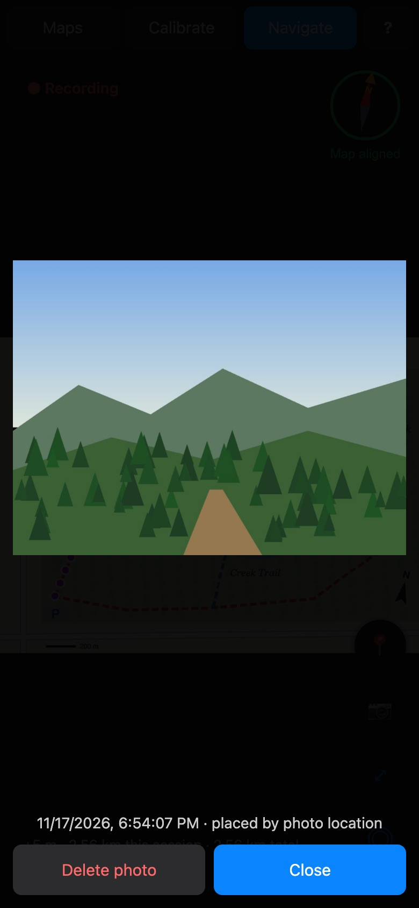
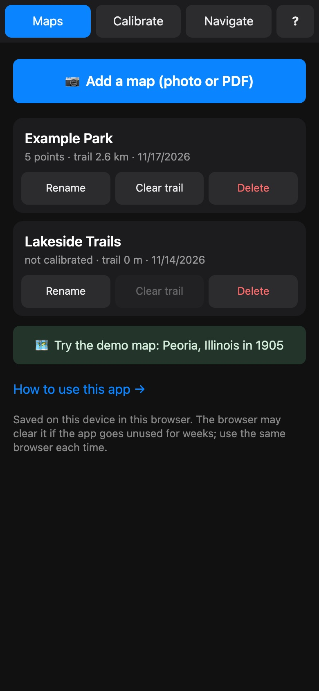
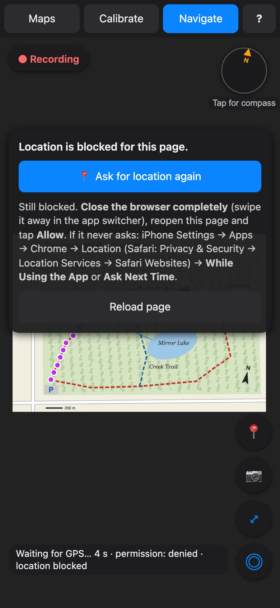

# How to use You Are Here

You Are Here puts a live GPS dot on a picture of a trail map: a photo of a
trailhead board, a park brochure, or a PDF from a club website. You line the map up
with satellite imagery once. After that it shows where you are *on that map*, draws
the trail you've covered, and pins the photos you took along the way.

Everything stays on your phone. The only thing it downloads is satellite and street
map tiles, and only while you're lining a map up.

*The screenshots below use a made-up example map.*

---

**Want to see it first?** On **Maps**, tap **Try the demo map**: a 1905 U.S.
Geological Survey map of Peoria, Illinois, already lined up with today's satellite view.

## 1. Add a map

Tap **Add a map (photo or PDF)**. You can take a photo, pick one from your library,
or choose a PDF. If the PDF has several pages, the app asks which page is the map.

**Maps with built-in coordinates.** Some PDFs carry their own location data
("GeoPDFs"): USGS topographic maps, and many National Park Service and Forest
Service maps. Those open **ready to navigate, with no calibrating**. You'll see a
message saying so.

Tips for a good photo:

- Stand straight in front of the board, not at an angle.
- Get the whole map in the frame, and avoid glare.
- A PDF is better than a photo when the club or park offers one.

## 2. Line it up (Calibrate)

This is the one step that takes a minute. You match spots on your map (top) to the
same spots on the satellite view (bottom).

1. Tap a spot on the **map**, such as a trail junction, a parking lot, a road
   crossing or the tip of a lake.
2. Tap the **same spot** on the satellite view.
3. If either tap is a little off, zoom in and tap again. Then press **Add pair**.

**Two spots, far apart, are enough to start navigating.** With only two, though, the
app can't tell whether one is off. For a trail map you'll rely on, do **4 to 6 spots
spread around the edges** of the area you'll be in. After the first two, tapping the map
jumps the satellite view to where the app thinks that spot is, so the rest go quickly.

**Trails hidden by trees?** Tap the layers button (top right of the satellite view)
and choose **Map** or **Map overlay**. Street-map lines show the trails, so you can tap
real junctions.

**Fit ±N m** tells you how well your spots agree. Single digits are great; under
about 15 m is fine for finding the right trail at a junction.

With 5 or more pairs, the app spots a **mis-tap** and turns it red, along with how good
the fit would be without it. Delete it with **✕** and redo it.

**Ski maps and other stretchy maps.** Painted resort maps and panoramas aren't drawn to
scale: far slopes are squeezed and runs are bent to fit. If the fit error stays high
even with no mis-taps, the app suggests **Flexible**. With 4 or more pairs, tap
**Flexible (ski maps)**: the map then bends to pass exactly through every pair. It's
only as good as your pairs, so add them where you'll be: lift stations, run
junctions and the base lodge. If the app says the flexible fit "folds" near some
points, one of those is probably mis-tapped.

## 3. Navigate

Allow location when asked. The **blue dot** is you. The faint circle around it shows
how sure the GPS is: expect ±5 m outdoors, and much worse indoors. As you move,
**purple dots** mark where you've been. Earlier hikes show as fainter dots. The map stays where you put it: pan and pinch freely, even if you
go off the edge of the screen. **◎** zooms back to you, and **⤢** shows the whole map.

**Line the map up with the land.** The orange **N** on the compass shows where north
is on *your map*. Tap the compass to turn on the phone's compass (iPhone asks first).
A red needle then points to real north. Hold the phone flat and turn yourself until
they line up and it says **Map aligned**. Now left on the map is left in front of you.

### Sessions: pause, end, resume, crop

Each hike is a **session**. Opening Navigate starts one, or carries on the one you
haven't ended. The pill at the top left shows what's happening: **● Recording**,
**❚❚ Paused** or **■ Not recording**. Tap it for:

- **Pause / Resume:** stop dropping dots while you drive between trailheads or
  stop for lunch. Pausing doesn't add to your distance.
- **End session:** this hike is over. The next time you open Navigate, a new one
  starts.
- **Resume last:** carry on a session you ended.
- **Crop:** drag **Start** and **End** to drop dots from before you set off or after
  you finished, such as the drive home. Grey dots are the ones that will go.

**Battery.** By default the screen stays on. In the same menu you can switch to
**Battery saver**: the screen can turn off as usual, and dots are dropped whenever you
look at the map. A web page can't use GPS while the screen is off, so this is the
trade-off.

### Waypoints

Tap **📍** and paste a location: coordinates like `40.8312, -89.8015`, degrees and
minutes, or a full Google or Apple Maps link. Give it a name if you like. It appears as
a pulsing **⭐**, and the status line shows how far it is and which way to go in a
straight line (for example *⭐ Spring 870 m NE*). Tap a star to share it or delete it.

**Share link** makes a link that opens the app with that waypoint added. Send it to
someone who has the same map calibrated. Short links such as `maps.app.goo.gl/…` can't
be read; copy the coordinates instead.

## 4. Hike photos

Tap **📷** to add photos, during the hike or after it. Each one appears as a camera dot
on the map. Tap a dot to see the photo.

The app places each photo using the first of these that works:

1. the location saved in the photo,
2. the time it was taken, matched to your recorded trail,
3. where you are right now, if you just took it.

iPhones often remove the location from photos you give a website, which is why your
trail's times matter. After adding photos the app tells you how each one was placed,
and which it couldn't place.

## 5. Your maps

**Maps** lists every map on this phone, with its calibration and trail. Tap one to
open it. **Rename**, **Clear trail** and **Delete** do what they say.

Your maps are saved **in this browser on this phone**. Use the same browser each time,
not a private tab. If you don't open the app for a few weeks, the browser may clear it.

## 6. Put it on your home screen

In **Safari**, tap **Share** (the square with the arrow), then **Add to Home Screen**. In
**Chrome**, tap the **Share** icon in the address bar, then **Add to Home Screen**. It
opens full-screen like an app, and the phone won't clear its maps after a few weeks of
not using it.

On iPhone the home-screen app **keeps its own maps**, separate from your browser, so
add your maps again there. It also asks for location permission again the first time.

## 7. No signal on the trail

Once you've opened You Are Here with a connection, it **keeps working with no signal**:
your maps, GPS dot, trail, waypoints and these instructions all work offline. GPS
itself never needed signal.

- **Use Safari or the home-screen app for this.** iPhone doesn't let Chrome keep web
  apps offline, so in Chrome the page needs signal to open.
- **Calibrating needs a connection**, because the satellite view is downloaded. Set
  your map up before you lose signal.

---

## Troubleshooting

**"Location is blocked."** Tap **Ask for location again**. If it's still blocked,
close the browser completely (swipe it away in the app switcher) and open the page
again, then tap **Allow**. If it never asks, open iPhone **Settings → Apps → Chrome →
Location** (Safari: **Privacy & Security → Location Services → Safari Websites**) and
choose **While Using the App**.

**"Waiting for GPS" for a long time.** You're probably indoors. Step outside or near a
window. The status shows how long it has waited.

**The map disappeared but my dots are there.** Your position may be off the edge of
the map. That usually means one calibration pair is wrong, and the status line says
how far off you are. Tap **⤢** to see the whole map, then re-check your pairs on
**Calibrate**.

**"screen may sleep."** The phone wouldn't let the app keep the screen on. For a long
hike, set **Settings → Display & Brightness → Auto-Lock** to a longer time.

**"Compass not allowed."** Tap the compass again and choose **Allow**. Some browsers
don't offer a compass at all; the orange **N** still shows where north is on your map.

**A big PDF takes a while.** The loading screen shows each step with a timer. Large
park brochures can take a few seconds to draw.

**The dot is on the wrong trail.** Re-check your pairs on **Calibrate**. Add a pair
near where it went wrong, and delete any red ones.
